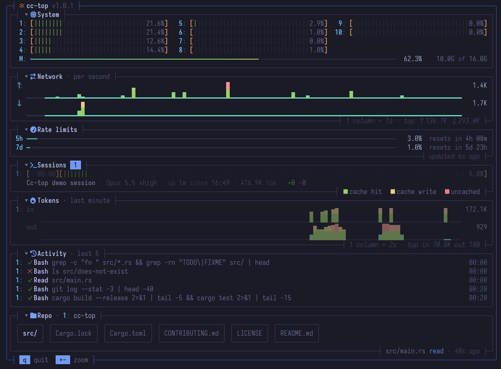

# cc-top

A terminal dashboard in the style of top for AI coding agents. It shows live context, token usage,
rate limits and file activity for Claude Code and opencode sessions, next to the CPU, memory and
network of the machine they run on.



## Features

- **Sessions**: context usage for each session, plus its model, effort, uptime, tokens and lines changed
- **Rate limits**: your 5-hour and 7-day usage, and when each resets (Pro/Max plans)
- **Tokens**: live input and output histograms per session
- **Activity**: the latest tool calls across all sessions, with status and duration
- **Repo**: the files and folders each session reads or edits flash as it works
- **System and Network**: per-core CPU, memory, and upload/download rates

## Install

```sh
cargo install cc-top
cc-top --setup
```

`--setup` points Claude Code's status line at cc-top. If opencode is installed, it also adds the
cc-top plugin; restart any open opencode windows to load it.

cc-top uses the status line to collect data and leaves it blank. If you already have a status line,
`--setup` stops and asks you to remove it from `~/.claude/settings.json` first.

To build from source instead:

```sh
git clone https://github.com/alejandroqh/cc-top
cd cc-top
cargo install --path .
```

Runs on macOS and Linux. A [Nerd Font](https://www.nerdfonts.com) is recommended for the panel
icons; everything else reads fine without one.

## Usage

```sh
cc-top
```

| Key                              | Action                                         |
| -------------------------------- | ---------------------------------------------- |
| `q` / `Esc`                      | quit                                           |
| `↑` `↓`, `PgUp` `PgDn`, wheel    | scroll                                         |
| `+` / `-`                        | zoom the Tokens timeline (1 s to 1 min per column) |
| click a folder in Repo           | look inside it (`../` goes back)               |
| click a panel's title (`▾` / `▸`) | collapse it to a summary, or expand it again   |

cc-top captures the mouse, so hold Shift (Option in iTerm2) to select text.

**Context bar.** Green is cache hits, yellow is cache writes, red is uncached input. A healthy
session is mostly green with a thin yellow tip. Percentages turn yellow at 80% and red at 90%.

## opencode

Works with opencode 2.x. Its sessions appear after the Claude Code ones, tagged `opencode`. A few
things differ:

- Rate limits are Claude Code's only.
- Lines changed and Repo flashes count opencode's file tools, not shell commands.
- A model with no known context limit shows `--`.

## Data and uninstall

Everything stays on your machine. cc-top keeps session data in `~/.claude/cc-top/` and deletes
any not updated for 7 days. The panels you collapsed are saved there too, in `collapsed`.

```sh
cc-top --uninstall    # removes the status line, the opencode plugin and the saved data
cargo uninstall cc-top
```

## Contributing

UI changes follow the style guide in [CONTRIBUTING.md](CONTRIBUTING.md).

## License

Copyright 2026 Alejandro Quintanar. Licensed under the [Apache License, Version 2.0](LICENSE).
